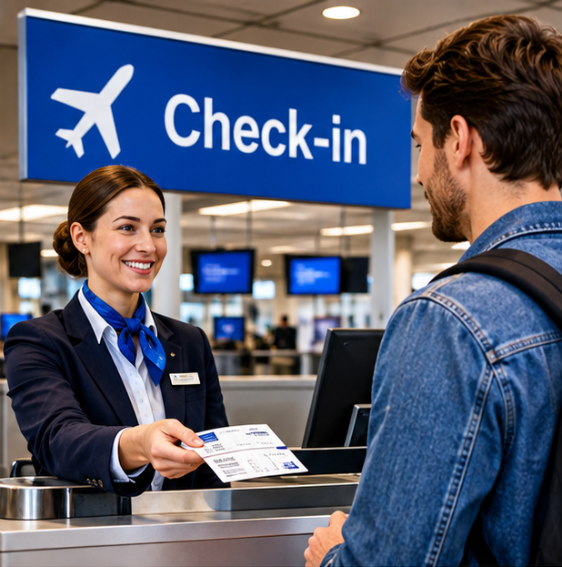
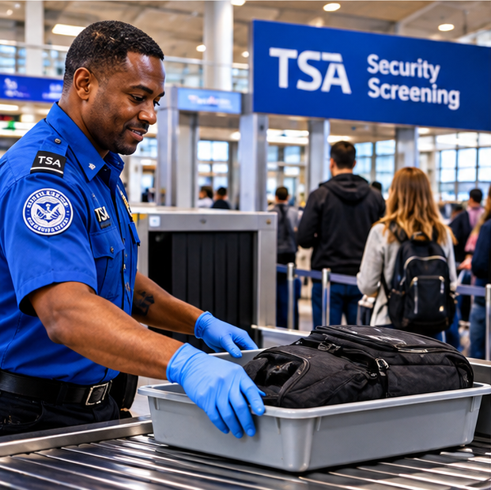
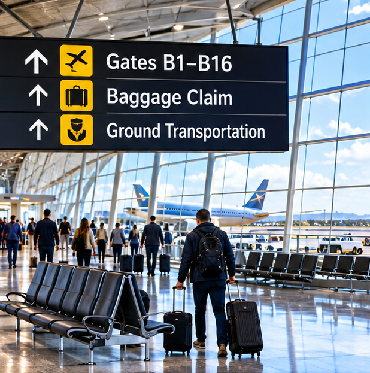
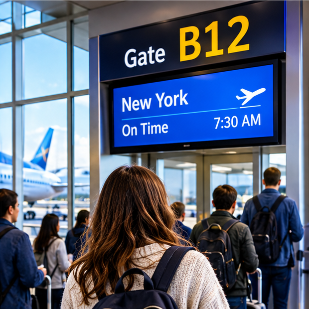

# Сценарий: в аэропорту — At the Airport

## От покупки билета до встречи в аэропорту прибытия

**American English Method · Everyday Scenarios**

---

## 🎧 Audio Practice — Listen to Real American English

Начнём с оригинальной американской аудиопрограммы VOA Learning English. Это учебная дикторская запись с чёткой, более медленной подачей, а не спонтанный разговор в аэропорту. В программе разбираются типичные ситуации: регистрация, документы, сдача багажа, досмотр, пересадки и задержки рейсов. Это наш первый уровень аудирования; позднее добавим более быструю естественную речь.

**Listen to the full program (7:06)**

<audio controls preload="none" style="display:block;width:100%;max-width:680px;margin:16px 0;">
  <source src="https://voa-audio.voanews.eu/vle/2018/12/12/57384861-be09-4a1c-b005-b8686f39f423_hq.mp3" type="audio/mpeg">
  Your browser does not support the audio player. <a href="https://learningenglish.voanews.com/a/words-to-travel-with-part-2-airports/4697903.html">Open the original VOA audio lesson</a>.
</audio>

**Your listening task**

При первом прослушивании не пытайся понять каждое слово. Определи, какие этапы путешествия обсуждаются. При втором прослушивании обрати внимание на эти реальные фразы из программы:

| Phrase | Значение |
|---|---|
| “May I see your ID?” | Можно посмотреть ваше удостоверение личности? |
| “Will you be checking any bags today?” | Вы будете сдавать багаж сегодня? |
| “Please place your bag on the scale.” | Пожалуйста, поставьте сумку на весы |
| “Please have your IDs and boarding passes out.” | Приготовьте документы и посадочные талоны |
| “Are you traveling with any liquids?” | Вы провозите жидкости? |
| “I missed my connecting flight.” | Я опоздал на стыковочный рейс |

**Now practise**

1. Выбери две фразы, которые особенно полезны для тебя.
2. Прослушай соответствующий фрагмент в оригинальной программе и повтори фразу вслух.
3. Закрой английский текст и попробуй воспроизвести фразу по памяти.
4. Сравни услышанное с нашим диалогом ниже: какие выражения совпадают, а какие сформулированы иначе?

**Source:** VOA Learning English, “Words to Travel With, Part 2: Airports” (December 13, 2018). The original VOA Learning English MP3 is used with attribution. The recording opens on the VOA audio server; the full transcript and original publication are available at the source link: [Read the original VOA lesson](https://learningenglish.voanews.com/a/words-to-travel-with-part-2-airports/4697903.html).

---

### 1. Ситуация — The Situation

Ты летишь в США. Тебе предстоит пройти несколько этапов путешествия:

1. Купить авиабилет — **Book a flight**
2. Зарегистрироваться на рейс — **Check in**
3. Сдать багаж — **Drop off your checked bag**
4. Пройти досмотр — **Go through security**
5. Найти выход на посадку — **Find your gate**
6. Сесть в самолёт — **Board the plane**
7. Пройти пограничный контроль после прибытия — **Go through immigration**
8. Получить багаж — **Pick up your luggage**
9. Встретиться с человеком, который тебя ожидает — **Meet someone at arrivals**

Если у тебя пересадка, добавляются новые задачи: найти следующий выход на посадку, пройти повторный досмотр, если он требуется, и успеть на стыковочный рейс.

В этом уроке мы будем использовать современный повседневный американский английский — такой, который можно услышать в обычном аэропорту США.

**Главная задача урока:** научиться самостоятельно ориентироваться в аэропорту, понимать инструкции, задавать вопросы и спокойно решать типичные проблемы.

---

### 2. Этап 1. Покупка авиабилета — Booking a Flight

Сегодня большинство пассажиров покупают билеты через сайты авиакомпаний, приложения или туристические сервисы. В аэропорту также могут продаваться билеты, если авиакомпания предоставляет такую услугу.

**Диалог — Booking a Flight**

**Travel Agent:** Hi! Where would you like to fly?

**You:** I'd like to book a flight to New York.

**Travel Agent:** Sure. When would you like to travel?

**You:** This Friday, if possible. I'd prefer a morning flight.

**Travel Agent:** We have a flight departing at 7:30 AM. Would that work for you?

**You:** That works. How much is a one-way ticket?

**Travel Agent:** It's two hundred and forty dollars.

**You:** All right. I'll take it.

**Travel Agent:** Great. You're all set.

**You:** Thank you.

#### Разбор выражений

| Выражение | Значение | Употребление |
|---|---|---|
| `I'd like to book a flight to...` | Я хотел бы забронировать рейс до... | Вежливая просьба |
| `When would you like to travel?` | Когда вы хотели бы лететь? | Вопрос о дате |
| `I'd prefer a morning flight.` | Я бы предпочёл утренний рейс | Выражение предпочтения |
| `Departing at 7:30 AM` | Отправляющийся в 7:30 утра | Время вылета |
| `Would that work for you?` | Вам это подходит? | Уточнение |
| `That works.` | Мне подходит | Естественное согласие |
| `One-way ticket` | Билет в одну сторону | Без обратного перелёта |
| `Round-trip ticket` | Билет туда и обратно | С обратным перелётом |
| `I'll take it.` | Я беру его | Подтверждение выбора |
| `You're all set.` | Всё готово | Подтверждение завершения оформления |

**Полезные выражения:**

- `I'd like a window seat.` — Я хотел бы место у окна.
- `I'd prefer an aisle seat.` — Я предпочёл бы место у прохода.
- `Can I choose my seat?` — Могу я выбрать место?
- `How long is the flight?` — Сколько длится перелёт?
- `Is there a layover?` — Есть ли пересадка?
- `Is it a nonstop flight?` — Это беспосадочный рейс?
- `What's the total price?` — Какова общая стоимость?

**Запомни:**

- `Window seat` — место у окна.
- `Aisle seat` — место у прохода.
- `Middle seat` — место посередине.
- `One-way` — в одну сторону.
- `Round-trip` — туда и обратно.

---

### 3. Этап 2. Регистрация и сдача багажа — Check-in and Baggage Drop

Покупка билета и регистрация на рейс — не одно и то же.

| Термин | Значение |
|---|---|
| `Booking a flight` | Покупка или бронирование билета |
| `Check-in` | Регистрация на рейс |
| `Boarding pass` | Посадочный талон |
| `Bag drop` | Место сдачи зарегистрированного багажа |
| `Checked bag` | Чемодан, сдаваемый в багаж |
| `Carry-on bag` | Ручная кладь |
| `Personal item` | Небольшая личная вещь |

Регистрацию обычно можно пройти онлайн или непосредственно в аэропорту. Это зависит от авиакомпании и условий путешествия.

**Диалог — At the Check-in Counter**

**Airline Agent:** Good morning. Are you checking in for your flight?

**You:** Yes. I'm flying to New York.

**Airline Agent:** May I see your passport, please?

**You:** Sure. Here you go.

**Airline Agent:** Do you have any bags to check?

**You:** Yes, one suitcase.

**Airline Agent:** Please place it on the scale.

**You:** Here it is.

**Airline Agent:** All right. Your bag is checked through to New York. Here's your boarding pass.

**You:** Thank you. Where do I go for security?

**Airline Agent:** Just follow the signs to the security checkpoint.

#### Разбор выражений

| Выражение | Значение | Употребление |
|---|---|---|
| `Are you checking in?` | Вы проходите регистрацию? | Вопрос сотрудника |
| `I'm flying to New York.` | Я лечу в Нью-Йорк | Указание направления |
| `May I see your passport?` | Можно посмотреть ваш паспорт? | Проверка документов |
| `Do you have any bags to check?` | У вас есть багаж для сдачи? | Вопрос о багаже |
| `Place it on the scale.` | Поставьте его на весы | Инструкция |
| `Your bag is checked through to...` | Ваш багаж оформлен до... | Багаж зарегистрирован до пункта назначения |
| `Here's your boarding pass.` | Вот ваш посадочный талон | Передача посадочного талона |
| `Security checkpoint` | Пункт досмотра | Зона проверки безопасности |

**Ещё полезные фразы:**

- `Can I check this bag?` — Можно сдать эту сумку в багаж?
- `Is there an extra charge for this bag?` — За эту сумку нужно доплатить?
- `What's the baggage allowance?` — Какая норма провоза багажа?
- `Is this bag within the weight limit?` — Этот багаж укладывается в ограничение по весу?
- `Where is the bag drop?` — Где сдавать багаж?
- `Can I bring this as a carry-on?` — Могу ли я взять это в ручную кладь?

**Важно различать:**

- `Checked luggage` / `checked baggage` — зарегистрированный багаж.
- `Carry-on` / `carry-on bag` — ручная кладь.
- `Personal item` — небольшая личная вещь, например сумка или рюкзак, если она разрешена правилами авиакомпании.

**Обрати внимание:** выражение `checked through to New York` предполагает, что багаж оформлен до конечного пункта. При пересадке это не всегда происходит автоматически.

---

### 4. Этап 3. Досмотр TSA — Security Screening

В аэропортах США пассажирский досмотр обычно выполняет TSA — **Transportation Security Administration**.

Сотрудники могут попросить положить вещи на ленту, достать отдельные предметы из сумки или пройти через сканер.

Процедуры могут отличаться в зависимости от аэропорта, оборудования и типа линии досмотра. Поэтому главное правило — внимательно слушать инструкции сотрудника.

**Диалог — At the Security Checkpoint**

**TSA Officer:** Good morning. Please place your bag on the belt.

**You:** Sure.

**TSA Officer:** Do you have a laptop or any large electronic devices?

**You:** Yes. Should I take my laptop out?

**TSA Officer:** Yes, please place it in a separate bin.

**You:** All right. Do I need to take my shoes off?

**TSA Officer:** Please follow the instructions on the screen.

**You:** Got it.

**TSA Officer:** Step through the scanner, please.

*(Ты проходишь через сканер.)*

**TSA Officer:** You're good. Have a safe flight.

**You:** Thank you.

#### Разбор выражений

| Выражение | Значение | Употребление |
|---|---|---|
| `Place your bag on the belt.` | Положите сумку на ленту | Инструкция |
| `Large electronic devices` | Крупные электронные устройства | Например, ноутбук |
| `Should I take my laptop out?` | Мне достать ноутбук? | Уточнение |
| `A separate bin` | Отдельный лоток | Контейнер для досмотра |
| `Do I need to take my shoes off?` | Мне нужно снять обувь? | Уточнение |
| `Follow the instructions.` | Следуйте инструкциям | Общая инструкция |
| `Step through the scanner.` | Пройдите через сканер | Инструкция |
| `You're good.` | Всё в порядке | Разговорное подтверждение |
| `Have a safe flight.` | Хорошего полёта | Пожелание |

**Полезные фразы:**

- `Where should I put my belongings?` — Куда положить мои вещи?
- `Do I need a separate bin for this?` — Для этого нужен отдельный лоток?
- `Could you explain what I need to do?` — Не могли бы вы объяснить, что мне нужно сделать?
- `I have medication in my bag.` — У меня в сумке лекарства.
- `I have a medical device with me.` — У меня с собой медицинское устройство.

**Культурная заметка:**

`TSA PreCheck` — программа ускоренного досмотра для предварительно одобренных путешественников. Она не означает полного освобождения от проверки.

Не нужно заранее запоминать все возможные инструкции. Важно понимать их и спокойно уточнять, если что-то непонятно.

---

### 5. Этап 4. Поиск выхода на посадку — Finding Your Gate

После досмотра нужно найти свой выход на посадку.

Информация о выходе и времени посадки указывается на посадочном талоне и электронных табло. Выход может измениться, поэтому проверяй объявления и экраны.

**Диалог — Finding the Gate**

**You:** Excuse me, could you tell me where Gate B12 is?

**Airport Staff:** Sure. Go straight ahead and turn left.

**You:** Is it far from here?

**Airport Staff:** No, it's about a five-minute walk.

**You:** Thank you.

*(Ты подходишь к выходу на посадку.)*

**You:** Excuse me, is this the gate for the flight to New York?

**Gate Agent:** Yes, it is. Boarding will begin at 6:50.

**You:** Great. Thank you.

#### Разбор выражений

| Выражение | Значение | Употребление |
|---|---|---|
| `Where is Gate B12?` | Где выход B12? | Вопрос о выходе |
| `Go straight ahead.` | Идите прямо | Направление |
| `Turn left.` | Поверните налево | Направление |
| `Is it far from here?` | Это далеко отсюда? | Уточнение расстояния |
| `About a five-minute walk` | Примерно пять минут пешком | Оценка расстояния |
| `Is this the gate for...?` | Это выход на рейс до...? | Проверка направления |
| `Boarding will begin at...` | Посадка начнётся в... | Информация о посадке |

**Полезные слова:**

- `Departure` — вылет.
- `Arrival` — прибытие.
- `Gate` — выход на посадку.
- `Terminal` — терминал.
- `Departure board` — табло вылета.
- `Flight number` — номер рейса.
- `Boarding time` — время начала посадки.
- `Final call` — последнее объявление о посадке.

**Полезные фразы:**

- `Has the gate changed?` — Выход изменился?
- `Is the flight on time?` — Рейс отправляется по расписанию?
- `Has the flight been delayed?` — Рейс задержан?
- `How much time do I have before boarding?` — Сколько времени осталось до посадки?

---

### 6. Этап 5. Посадка в самолёт — Boarding the Plane

Пассажиров часто приглашают на посадку группами или зонами. Порядок посадки зависит от авиакомпании.

**Диалог — At the Gate**

**Gate Agent:** Now boarding Zone 1. Please have your boarding pass and ID ready.

**You:** Excuse me, is this the line for Zone 2?

**Gate Agent:** Yes, it is. We'll call Zone 2 shortly.

*(Через некоторое время.)*

**Gate Agent:** Now boarding Zone 2.

**You:** Here's my boarding pass.

**Gate Agent:** Thank you. You're all set. Have a good flight.

**You:** Thanks.

#### Разбор выражений

| Выражение | Значение | Употребление |
|---|---|---|
| `Now boarding Zone 1.` | Начинается посадка группы 1 | Объявление |
| `Have your boarding pass ready.` | Приготовьте посадочный талон | Инструкция |
| `ID` | Документ, удостоверяющий личность | Сокращение от identification |
| `Is this the line for Zone 2?` | Это очередь для группы 2? | Уточнение |
| `We'll call Zone 2 shortly.` | Скоро объявим группу 2 | Объявление |
| `You're all set.` | Всё готово | Подтверждение |

**Полезные фразы:**

- `Am I in the right line?` — Я стою в правильной очереди?
- `Can I board now?` — Я могу уже пройти на посадку?
- `Where should I scan my boarding pass?` — Где мне отсканировать посадочный талон?

---

### 7. Этап 6. В самолёте — On the Plane

**Диалог — On Board**

**Flight Attendant:** Welcome aboard. Your seat is 14A, on the left.

**You:** Thank you.

*(Ты находишь своё место.)*

**You:** Excuse me, could you help me with my bag?

**Flight Attendant:** Of course. I'll help you put it in the overhead bin.

**You:** Thank you. Could I get a glass of water?

**Flight Attendant:** Certainly. I'll be right back with that.

*(Во время полёта.)*

**Flight Attendant:** Would you like something to drink?

**You:** Yes, coffee, please. And do you have any snacks?

**Flight Attendant:** We have pretzels and cookies. Which would you like?

**You:** Pretzels, please.

*(Перед посадкой.)*

**Flight Attendant:** Ladies and gentlemen, we're beginning our descent. Please fasten your seatbelts and put your tray tables up.

#### Разбор выражений

| Выражение | Значение | Употребление |
|---|---|---|
| `Welcome aboard.` | Добро пожаловать на борт | Приветствие |
| `Your seat is 14A.` | Ваше место 14A | Информация о месте |
| `Could you help me with my bag?` | Не могли бы вы помочь с моей сумкой? | Вежливая просьба |
| `Overhead bin` | Верхняя багажная полка | Место для ручной клади |
| `Could I get a glass of water?` | Можно мне стакан воды? | Вежливая просьба |
| `I'll be right back with that.` | Я сейчас вернусь с этим | Ответ сотрудника |
| `Would you like something to drink?` | Хотите что-нибудь выпить? | Предложение |
| `Pretzels` | Солёные крендельки | Популярная закуска |
| `We're beginning our descent.` | Мы начинаем снижение | Объявление экипажа |
| `Fasten your seatbelts.` | Пристегните ремни | Инструкция |
| `Put your tray tables up.` | Уберите откидные столики | Инструкция |

**Дополнительные выражения:**

- `Is this seat taken?` — Это место занято?
- `Could I switch seats with you?` — Не могли бы вы поменяться со мной местами?
- `Where's the lavatory?` — Где туалет?
- `Could I have a blanket?` — Можно мне одеяло?
- `I'm feeling a little airsick.` — Меня немного укачивает в самолёте.
- `I don't feel well.` — Я плохо себя чувствую.

**Обрати внимание:**

`Overhead bin` — обычное американское название верхнего отделения для ручной клади. В повседневной речи также часто говорят `overhead compartment`.

---

### 8. Этап 7. Пересадка — Connecting Flights

Если у тебя стыковочный рейс, после выхода из самолёта нужно найти направление к следующему выходу на посадку.

В международных аэропортах порядок действий может отличаться.

При международном прибытии в США пассажир обычно проходит пограничный контроль в первом аэропорту въезда. Если затем следует внутренний рейс, может потребоваться получить багаж и повторно сдать его. Конкретная процедура зависит от аэропорта, маршрута и условий перевозки.

**Диалог — Finding a Connecting Flight**

**You:** Excuse me, I have a connecting flight to Dallas. Where should I go?

**Airport Staff:** Follow the signs for Connecting Flights and check the departure screens for your next gate.

**You:** Do I need to go through security again?

**Airport Staff:** It depends on the airport and your itinerary. Please follow the signs and ask airport staff if you're unsure.

**You:** All right. Thank you.

#### Разбор выражений

| Выражение | Значение | Употребление |
|---|---|---|
| `Connecting flight` | Стыковочный рейс | Рейс после пересадки |
| `I have a connecting flight to...` | У меня пересадка на рейс до... | Объяснение ситуации |
| `Where should I go?` | Куда мне идти? | Вопрос о направлении |
| `Connecting Flights` | Стыковочные рейсы | Указатель |
| `Departure screens` | Табло вылета | Электронные экраны |
| `Do I need to go through security again?` | Мне нужно снова пройти досмотр? | Уточнение |
| `It depends.` | Это зависит от обстоятельств | Универсальный ответ |
| `Your itinerary` | Ваш маршрут поездки | Информация о перелётах |

**Полезные фразы:**

- `How much time do I have before my next flight?` — Сколько времени до следующего рейса?
- `Do I have enough time to make my connection?` — У меня достаточно времени на пересадку?
- `Where is my connecting gate?` — Где выход на мой следующий рейс?
- `I missed my connection.` — Я опоздал на стыковочный рейс.
- `My connecting flight has been delayed.` — Мой следующий рейс задержан.
- `Can the airline rebook me?` — Может ли авиакомпания перебронировать мне рейс?

**Важно:** если ты не успеваешь на пересадку, сразу обратись к сотрудникам авиакомпании. Возможность бесплатного перебронирования зависит от причины задержки, условий билета и правил перевозчика.

---

### 9. Этап 8. Прибытие и паспортный контроль — Arrival and CBP Inspection

После прибытия международного рейса в США пассажиры проходят контроль CBP — **U.S. Customs and Border Protection**.

Сотрудник может спросить о цели поездки, сроке пребывания, месте проживания, маршруте и других обстоятельствах.

Отвечай спокойно, честно и по существу. Не заучивай ответы, которые не соответствуют твоей реальной ситуации.

**Диалог — At Passport Control**

**CBP Officer:** Passport, please.

**You:** Here you go.

**CBP Officer:** What's the purpose of your visit?

**You:** Tourism. I'm here on vacation.

**CBP Officer:** How long do you plan to stay?

**You:** Two weeks.

**CBP Officer:** Where will you be staying?

**You:** At a hotel in Manhattan.

**CBP Officer:** Do you have a return ticket?

**You:** Yes. Here it is.

**CBP Officer:** All right. Welcome to the United States.

**You:** Thank you.

#### Разбор выражений

| Выражение | Значение | Употребление |
|---|---|---|
| `Passport, please.` | Паспорт, пожалуйста | Запрос документа |
| `What's the purpose of your visit?` | Какова цель вашего визита? | Вопрос о цели поездки |
| `Tourism.` | Туризм | Краткий ответ |
| `I'm here on vacation.` | Я приехал в отпуск | Естественный ответ |
| `How long do you plan to stay?` | Как долго вы планируете оставаться? | Вопрос о сроке |
| `Where will you be staying?` | Где вы будете проживать? | Вопрос о месте проживания |
| `Do you have a return ticket?` | У вас есть обратный билет? | Возможный вопрос |
| `Here it is.` | Вот он | Передача документа |
| `Welcome to the United States.` | Добро пожаловать в США | Приветствие |

**Другие возможные вопросы:**

- `What do you do for a living?` — Кем вы работаете?
- `Have you been to the United States before?` — Вы уже бывали в США?
- `Are you traveling alone?` — Вы путешествуете один?
- `Who are you visiting?` — К кому вы приехали?
- `How much money are you bringing with you?` — Сколько денег вы привезли с собой?
- `Are you carrying more than $10,000 in currency or monetary instruments?` — Вы перевозите более 10 000 долларов наличными или в других денежных инструментах?

**Если ты не понял вопрос:**

- `Could you repeat that, please?` — Не могли бы вы повторить?
- `Could you speak a little more slowly?` — Не могли бы вы говорить немного медленнее?
- `I'm sorry, I don't understand the question.` — Извините, я не понимаю вопрос.
- `I need an interpreter, please.` — Мне нужен переводчик.

**Важная культурно-правовая заметка:**

CBP — пограничная и таможенная служба США. Именно уполномоченный сотрудник CBP принимает решение о допуске путешественника в страну в соответствии с применимыми правилами.

Наличие действующей визы или одобренной ESTA само по себе не гарантирует въезд.

Не нужно считать обратный билет, бронь отеля или определённую сумму денег универсальной гарантией въезда. Требования зависят от основания поездки и конкретных обстоятельств.

Отвечай правдиво. Если не знаешь ответа, не придумывай его.

---

### 10. Этап 9. Получение багажа — Baggage Claim

После паспортного контроля следуй указателям `Baggage Claim`.

**Диалог — At Baggage Claim**

**You:** Excuse me, where can I find baggage claim?

**Airport Staff:** Go downstairs and follow the signs. Your flight's bags should arrive at Carousel 6.

**You:** Thank you.

*(У багажной ленты.)*

**You:** There it is! The black suitcase.

**Friend:** Is that yours?

**You:** Yes, that's mine. Let's grab it.

**Friend:** Great. Let's head out.

#### Разбор выражений

| Выражение | Значение | Употребление |
|---|---|---|
| `Baggage claim` | Зона получения багажа | Место выдачи багажа |
| `Follow the signs.` | Следуйте указателям | Инструкция |
| `Carousel 6` | Багажная лента № 6 | Номер ленты |
| `There it is!` | Вот он! | Когда нашёл нужную вещь |
| `That's mine.` | Это моё | Подтверждение |
| `Let's grab it.` | Давай заберём его | Разговорная фраза |
| `Let's head out.` | Давай выйдем | Завершение |

**Различия:**

- `Baggage claim` — зона получения багажа.
- `Baggage carousel` — вращающаяся багажная лента.
- `Baggage claim tag` — багажная бирка, по которой идентифицируют багаж.

---

### 11. Этап 10. Потерянный или повреждённый багаж — Lost or Damaged Luggage

Иногда чемодан не появляется на ленте или прибывает повреждённым. В такой ситуации нужно обратиться к представителю авиакомпании или в службу розыска багажа.

**Диалог — Missing Luggage**

**You:** Excuse me. My suitcase hasn't arrived.

**Airline Staff:** I'm sorry to hear that. Could you describe your bag?

**You:** It's a large black suitcase with a red tag.

**Airline Staff:** Do you have your baggage claim tag?

**You:** Yes, here it is.

**Airline Staff:** Thank you. We'll help you file a report.

**You:** How can I contact you about my luggage?

**Airline Staff:** We'll give you a reference number and contact information.

**You:** Thank you for your help.

#### Разбор выражений

| Выражение | Значение | Употребление |
|---|---|---|
| `My suitcase hasn't arrived.` | Мой чемодан не прибыл | Сообщение о проблеме |
| `Could you describe your bag?` | Не могли бы вы описать свою сумку? | Уточнение |
| `A red tag` | Красная бирка | Описание багажа |
| `Baggage claim tag` | Багажная бирка | Идентификация багажа |
| `File a report` | Оформить заявление | Регистрация проблемы |
| `Reference number` | Номер обращения | Для дальнейшего отслеживания |
| `Contact information` | Контактная информация | Данные для связи |

**Полезные фразы:**

- `My bag is missing.` — Мой багаж пропал.
- `My suitcase was damaged.` — Мой чемодан повреждён.
- `The handle is broken.` — Ручка сломана.
- `The wheels are damaged.` — Колёса повреждены.
- `Where can I report missing luggage?` — Где можно заявить о пропаже багажа?
- `How can I track my bag?` — Как я могу отслеживать свой багаж?
- `When can I expect an update?` — Когда я могу ожидать обновление информации?

**Практический совет:** если багаж повреждён, сообщи об этом представителю авиакомпании как можно скорее, желательно до выхода из зоны получения багажа. Сохрани багажную бирку и номер обращения.

---

### 12. Этап 11. Встреча в аэропорту — Meeting Someone at the Airport

**Диалог — At Arrivals**

**Friend:** Hey! Over here!

**You:** Hey! Good to see you!

**Friend:** How was your flight?

**You:** It was fine. A little long, but everything went smoothly.

**Friend:** Did you get your bags?

**You:** Yeah, I got everything. Thanks for picking me up.

**Friend:** No problem. Let's head out. The car's parked outside.

**You:** Sounds good. Thanks again for the ride.

#### Разбор выражений

| Выражение | Значение | Употребление |
|---|---|---|
| `Over here!` | Я здесь! Сюда! | Привлечение внимания |
| `Good to see you!` | Рад тебя видеть! | Встреча |
| `How was your flight?` | Как прошёл полёт? | Обычный вопрос |
| `Everything went smoothly.` | Всё прошло гладко | Положительная оценка |
| `Did you get your bags?` | Ты получил свой багаж? | Вопрос о багаже |
| `Thanks for picking me up.` | Спасибо, что встретил меня | Благодарность |
| `Let's head out.` | Давай пойдём | Разговорное выражение |
| `Thanks again for the ride.` | Ещё раз спасибо, что подвёз | Благодарность за поездку |

---

### 13. Культурная заметка: аэропорты в США — Airport Vocabulary

| Термин | Значение |
|---|---|
| `TSA` | Transportation Security Administration — служба досмотра |
| `CBP` | Customs and Border Protection — пограничная и таможенная служба |
| `Check-in` | Регистрация на рейс |
| `Boarding pass` | Посадочный талон |
| `Gate` | Выход на посадку |
| `Terminal` | Терминал |
| `Carry-on` | Ручная кладь |
| `Checked luggage` | Сданный багаж |
| `Personal item` | Личная вещь небольшого размера |
| `Baggage claim` | Зона получения багажа |
| `Carousel` | Багажная лента |
| `Connecting flight` | Стыковочный рейс |
| `Layover` | Пересадка / время ожидания между рейсами |
| `Direct flight` | Прямой рейс с возможной промежуточной остановкой |
| `Nonstop flight` | Беспосадочный рейс |
| `Departure` | Вылет |
| `Arrival` | Прибытие |
| `Delay` | Задержка |
| `Cancelled` | Отменён |
| `Boarding time` | Время начала посадки |
| `Final call` | Последнее объявление о посадке |

**Несколько важных различий:**

- `Direct flight` — прямой рейс, который может включать промежуточную остановку.
- `Nonstop flight` — беспосадочный рейс.
- `Layover` — промежуток между рейсами.
- `Connecting flight` — следующий рейс в маршруте с пересадкой.

**Обрати внимание:** в США часто говорят `flight` — рейс, а не `plane`, когда речь идёт о расписании, номере или статусе перелёта.

Например:

- `My flight is delayed.` — Мой рейс задерживается.
- `What time does your flight leave?` — Во сколько отправляется твой рейс?
- `Which flight are you on?` — Каким рейсом ты летишь?

---

### 14. Региональный слой — Southern English

В аэропорту основным языком общения остаётся нейтральный американский английский. Но в непринуждённом разговоре с другими пассажирами или знакомыми можно услышать региональные выражения.

**Y'all** — разговорное обращение к нескольким людям, особенно характерное для южных штатов.

Пример:

**Passenger:** Y'all flying to Dallas, too?

**You:** Yeah, we're on the same flight.

Перевод:

**Пассажир:** Вы тоже летите в Даллас?

**Ты:** Да, мы на одном рейсе.

**Важно:**

- `Y'all` — не исключительно техасское выражение, но особенно характерно для Юга США.
- Оно широко понятно американцам.
- В официальном общении с сотрудниками аэропорта лучше использовать нейтральные формы.
- Не нужно специально вставлять `y'all` в каждую фразу.

---

### 15. Connected Speech — Как звучит разговорный американский английский

В повседневной речи американцы часто соединяют слова и сокращают звуки. Это не означает, что нужно писать их так же, как они звучат.

| Обычная форма | Разговорное звучание | Пример |
|---|---|---|
| `Could you...?` | `Couldja...?` | `Couldja help me with my bag?` |
| `Would you...?` | `Wouldja...?` | `Wouldja like something to drink?` |
| `What are you...?` | `Whatcha...?` | `Whatcha looking for?` |
| `Did you...?` | `Didja...?` | `Didja get your bags?` |
| `Going to` | `Gonna` | `I'm gonna check in.` |

**Запомни:**

`Couldja`, `whatcha` и `didja` — условная передача разговорного звучания сочетаний слов. `Gonna` — распространённая неформальная редуцированная форма `going to`; её можно встретить и в разговорной записи, но в нейтральном письме лучше использовать стандартную форму. Эти особенности не являются исключительно южными. В обычной письменной речи используй стандартные формы:

- `Could you help me?`
- `What are you looking for?`
- `Did you get your bags?`
- `I'm going to check in.`

---

### 16. Практика — Practice

**Упражнение 1. Покупка билета и регистрация**

Ситуация: ты покупаешь билет до Нью-Йорка.

**Agent:** Where would you like to fly?

**You:** *(Назови направление и скажи, что хочешь билет в одну сторону.)*

**Agent:** When would you like to travel?

**You:** *(Назови дату и предпочтительное время.)*

**Agent:** Would you prefer a window seat or an aisle seat?

**You:** *(Выбери место.)*

**Agent:** Do you have any bags to check?

**You:** *(Скажи, сколько у тебя чемоданов.)*

**Твоя задача:** провести разговор от выбора рейса до получения посадочного талона.

---

**Упражнение 2. Паспортный контроль**

**CBP Officer:** Passport, please.

**You:** *(Передай паспорт.)*

**CBP Officer:** What's the purpose of your visit?

**You:** *(Объясни настоящую цель поездки.)*

**CBP Officer:** How long do you plan to stay?

**You:** *(Назови срок.)*

**CBP Officer:** Where will you be staying?

**You:** *(Назови место проживания.)*

**CBP Officer:** Have you been to the United States before?

**You:** *(Ответь правдиво.)*

**Твоя задача:** отвечать коротко, понятно и естественно. Не нужно добавлять лишние объяснения, если их не спрашивают.

---

**Упражнение 3. Проблема в аэропорту**

Выбери одну ситуацию и разыграй диалог.

**Situation A — Ты не можешь найти выход на посадку.**

Используй:

- `Excuse me...`
- `Where is Gate...?`
- `Is it far from here?`

**Situation B — Ты опоздал на стыковочный рейс.**

Используй:

- `I missed my connection.`
- `What should I do?`
- `Can the airline rebook me?`

**Situation C — Твой чемодан не прибыл.**

Используй:

- `My suitcase hasn't arrived.`
- `Could you help me?`
- `Here's my baggage claim tag.`

**Твоя задача:** не просто повторить готовый диалог, а самостоятельно объяснить проблему и попросить помощи.

---

**Упражнение 4. Объясни дорогу**

Представь, что другой пассажир не может найти свой выход на посадку.

Объясни ему, как пройти:

- прямо;
- налево;
- направо;
- до следующего терминала.

Используй:

- `Go straight ahead.`
- `Turn left.`
- `Turn right.`
- `Follow the signs.`
- `It's about a five-minute walk.`

---

### 17. Обратная связь после практики — Feedback

Работаем по циклу:

**Practice → Learner's Response → Correction → Natural Reformulation → Recall**

**Пример 1**

Ученик говорит:

`I want a ticket to New York.`

- **Correction:** грамматически правильно.
- **Natural Reformulation:** `I'd like a ticket to New York, please.` — более мягкая и вежливая формулировка.
- **Recall:** повтори естественный вариант.

**Пример 2**

Ученик говорит:

`I go to vacation.`

- **Correction:** нужна конструкция `on vacation`.
- **Natural Reformulation:** `I'm here on vacation.` — Я здесь в отпуске.
- **Recall:** повтори фразу самостоятельно.

**Пример 3**

Ученик говорит:

`I have one bag.`

- **Correction:** грамматически правильно, но не уточняется, какой это багаж.
- **Natural Reformulation:** `I have one checked bag and one carry-on.` — У меня один чемодан в багаж и одна сумка в ручную кладь.
- **Recall:** повтори фразу.

**Пример 4**

Ученик говорит:

`Where is my plane?`

- **Correction:** грамматически правильно, но в аэропорту вопрос слишком общий.
- **Natural Reformulation:** `Where is my gate?` — Где мой выход на посадку?
- **Recall:** повтори естественную формулировку.

**Пример 5**

Ученик говорит:

`My baggage is lost.`

- **Correction:** понятно и грамматически возможно.
- **Natural Reformulation:** `My luggage hasn't arrived.` — Мой багаж ещё не прибыл.
- **Recall:** повтори естественный вариант.

**Важно:** альтернативная формулировка не всегда означает исправление ошибки. Мы различаем грамматику, естественность, точность и ситуацию общения.

---

### 18. Статус лексики — Vocabulary Status

**🟢 Активно — использовать самостоятельно**

- `I'd like to book a flight to...`
- `One-way ticket`
- `Round-trip ticket`
- `I'd prefer a morning flight.`
- `I'd like a window seat.`
- `I'm checking in.`
- `Do you have any bags to check?`
- `Here's your boarding pass.`
- `Where is Gate B12?`
- `Is this the gate for...?`
- `Have a good flight.`
- `Could I get a glass of water?`
- `What's the purpose of your visit?`
- `I'm here on vacation.`
- `How long do you plan to stay?`
- `Where will you be staying?`
- `Where is baggage claim?`
- `My suitcase hasn't arrived.`
- `Thanks for picking me up.`
- `I missed my connection.`
- `Could you repeat that, please?`

**🟡 Понимать — узнавать в контексте**

- `TSA`
- `CBP`
- `Security screening`
- `Carry-on`
- `Checked luggage`
- `Personal item`
- `Connecting flight`
- `Layover`
- `Departure`
- `Arrival`
- `Baggage claim`
- `Carousel`
- `Boarding zone`
- `Final call`
- `Reference number`
- `Overhead bin`
- `Baggage claim tag`
- `TSA PreCheck`

**🔴 Пассивная специализированная лексика — узнавать при необходимости**

- `Admissibility` — допустимость въезда.
- `Expedited removal` — ускоренная процедура выдворения.
- `Flight itinerary` — маршрут перелёта.

Эти термины относятся к более специализированному контексту и не являются необходимыми для обычного общения пассажира в аэропорту.

---

## Принцип урока

**Don't just get on a plane. Learn to navigate every step — from the ticket counter to the arrivals hall.**

Не просто садись в самолёт. Научись ориентироваться на каждом этапе — от покупки билета до выхода из аэропорта прибытия.

**Learn the language. Understand the procedure. Stay calm. Take the next step.**

*Learn the language. Understand the context. Express yourself naturally.*
