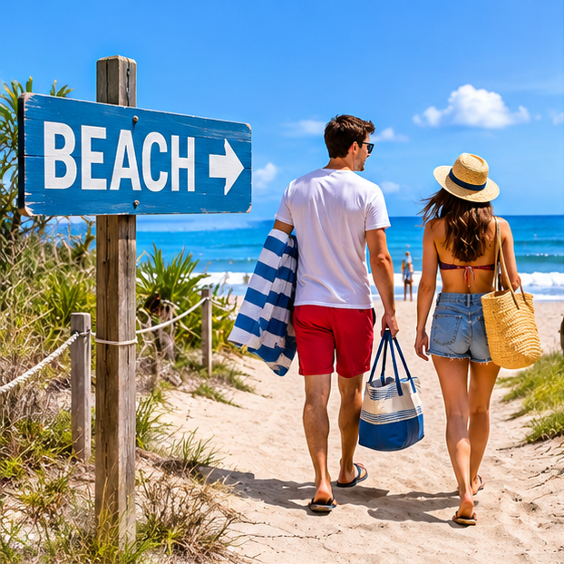
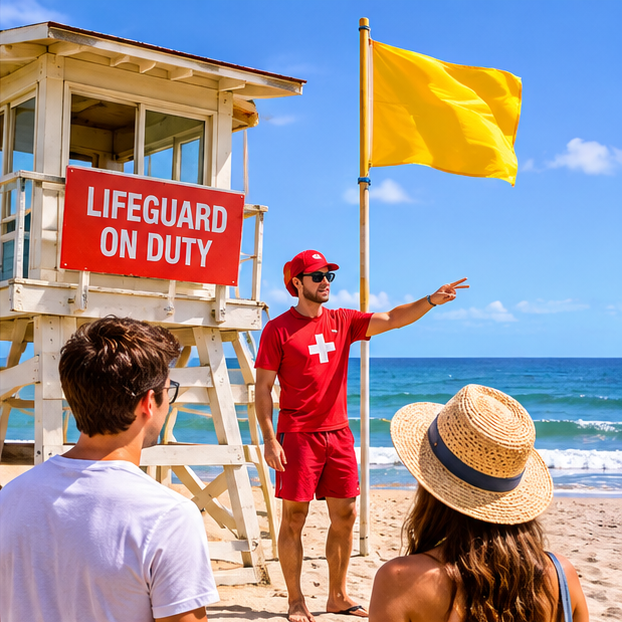
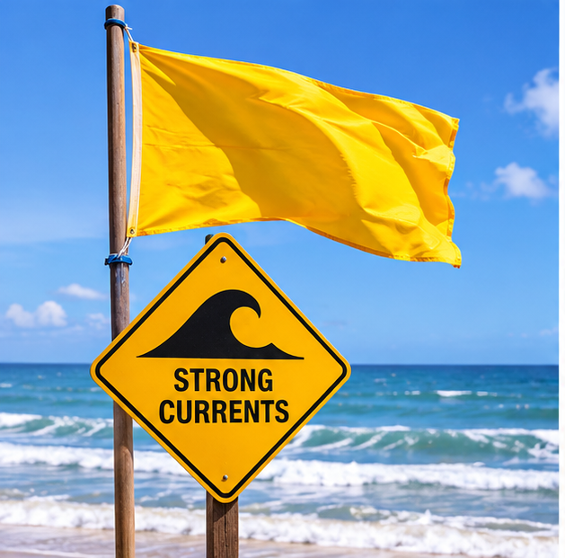
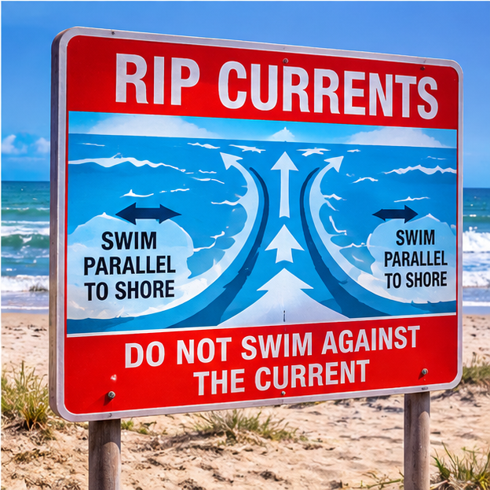

# Сценарий: на пляже — At the Beach

## Как найти место, искупаться и не обгореть

**American English Method**

**Тема:** Everyday Scenarios  
**Языковой фокус:** Nationwide American English + Southern English  
**Основной принцип:** Understand the Situation → Learn the Language → Speak Naturally

---

## 1. The Situation — Ситуация

Представь, что ты проводишь лето в США. Вы с другом решили съездить на пляж.

Вам нужно найти дорогу, выбрать место, расположиться на песке, узнать условия для купания, защититься от солнца и провести время у воды.

На пляже люди разговаривают, отдыхают, купаются, играют с детьми, заказывают напитки, спрашивают дорогу и обращаются к спасателям.

Наша задача — научиться естественно общаться во всех этих ситуациях.

## 2. Getting to the Beach — Как найти пляж

### A Natural Everyday Conversation

**Friend:** Hey, it's a beautiful day. How about going to the beach?

**You:** Sounds good! Do you know where the nearest beach is?

**Friend:** Sure. Just head down the main road and follow the signs. It's about a ten-minute walk from here.

**You:** Great! Is there a parking lot nearby?

**Friend:** Yeah, there's a parking lot right by the entrance. Look for the signs pointing to the beach access.

**You:** Good to know. Is there a lifeguard station?

**Friend:** Yeah, there should be one near the main swimming area.

**You:** Great. I'd rather swim where there's a lifeguard on duty.

**Перевод:**

**Друг:** Слушай, сегодня прекрасный день. Как насчёт съездить на пляж?

**Ты:** Отличная идея! Ты знаешь, где находится ближайший пляж?

**Друг:** Конечно. Иди по главной дороге и следуй указателям. Отсюда примерно десять минут пешком.

**Ты:** Отлично! Поблизости есть парковка?

**Друг:** Да, парковка прямо возле входа. Ищи указатели к проходу на пляж.

**Ты:** Хорошо. Там есть пост спасателей?

**Друг:** Да, он должен быть возле основной зоны для купания.

**Ты:** Отлично. Я предпочитаю купаться там, где дежурит спасатель.

### Useful Expressions

| Expression | Значение |
|---|---|
| How about going to the beach? | Как насчёт сходить на пляж? |
| Sounds good! | Звучит отлично! |
| The nearest beach | Ближайший пляж |
| Head down the main road | Иди по главной дороге |
| Follow the signs | Следуй указателям |
| A ten-minute walk | Десять минут пешком |
| Parking lot | Парковка |
| Right by the entrance | Прямо возле входа |
| Beach access | Проход или доступ к пляжу |
| Lifeguard station | Пост спасателей |
| Lifeguard on duty | Спасатель на дежурстве |

**Обрати внимание:**

- `Head down the main road` — иди дальше по главной дороге.
- `Head down Ocean Drive` — иди по улице Ocean Drive.
- `Beach access` — обозначенный проход или доступ к пляжу.
- `Lifeguard on duty` — спасатель находится на дежурстве.

Наличие спасателя не означает, что купаться безопасно при любых условиях. Всегда обращай внимание на предупреждения.

---

## 3. Finding a Spot — Выбираем место на пляже

**You:** This looks like a nice spot. Let's set up here.

**Friend:** Sure. Just make sure we're not too close to the water. The tide is coming in.

**You:** Good point. I see a yellow flag over there. What does that mean?

**Friend:** It usually means there may be moderate surf or currents. Let's check with the lifeguard before swimming.

**You:** Got it. The water looks a little rough today.

**Friend:** Yeah, and there's a sign warning about rip currents. Let's ask the lifeguard where it's safe to swim.

**You:** Good idea. I'd rather be careful.

**Friend:** Absolutely. We should stay in the designated swimming area and follow the lifeguard's instructions.

### Перевод

**Ты:** Здесь, кажется, хорошее место. Давай расположимся здесь.

**Друг:** Конечно. Только давай не слишком близко к воде. Начинается прилив.

**Ты:** Верно. Вон там я вижу жёлтый флаг. Что он означает?

**Друг:** Обычно он означает, что могут быть умеренные волны или течения. Давай перед купанием уточним у спасателя.

**Ты:** Понял. Сегодня море выглядит немного неспокойным.

**Друг:** Да, и там есть знак, предупреждающий об отбойных течениях. Давай спросим спасателя, где безопасно купаться.

**Ты:** Хорошая идея. Лучше быть осторожными.

**Друг:** Согласен. Нужно оставаться в обозначенной зоне для купания и следовать указаниям спасателя.

### Useful Expressions

| Expression | Значение |
|---|---|
| This looks like a nice spot. | Здесь, кажется, хорошее место |
| Let's set up here. | Давай расположимся здесь |
| Too close to the water | Слишком близко к воде |
| The tide is coming in. | Начинается прилив |
| What does that mean? | Что это означает? |
| The water looks rough. | Море выглядит неспокойным |
| Rip currents | Отбойные, или разрывные, течения |
| Designated swimming area | Обозначенная зона для купания |
| Follow the lifeguard's instructions. | Следуй указаниям спасателя |
| I'd rather be careful. | Я предпочитаю быть осторожным |

### A Few Important Differences

| Expression | Значение |
|---|---|
| The water is rough. | Вода неспокойная, сильное волнение |
| The water is choppy. | Поверхность воды покрыта небольшими волнами |
| The current is strong. | Течение сильное |
| The tide is coming in. | Начинается прилив |
| The tide is going out. | Начинается отлив |

---

## 4. Beach Flags and Safety — Пляжные флаги и безопасность

На многих пляжах США используют цветные флаги, чтобы предупреждать посетителей об условиях для купания.

Однако система обозначений может различаться в зависимости от пляжа, штата и местных правил.

Поэтому всегда читай информационные таблички и спрашивай спасателя, если не уверен в значении флага.

### Common Beach Flag Warnings

| Flag | Meaning |
|---|---|
| 🟢 Green | Низкая опасность, относительно спокойные условия |
| 🟡 Yellow | Умеренная опасность: волны или течения |
| 🔴 Red | Высокая опасность: сильные волны или течения |
| 🔴🔴 Double Red | Вода закрыта для купания |
| 🟣 Purple | Возможное присутствие опасных морских обитателей |
| 🔴🟡 Red over Yellow | Во многих системах обозначает зону для купания под наблюдением спасателей |

**Важно:**

- Два красных флага — не то же самое, что один красный флаг.
- В системе USLA красно-жёлтый флаг — это один флаг, разделённый на две горизонтальные половины: красную сверху и жёлтую снизу. Он обозначает зону, находящуюся под наблюдением спасателей. Местные системы могут отличаться.
- Один жёлтый флаг обычно предупреждает об умеренной опасности.
- Даже зелёный флаг не гарантирует полного отсутствия опасности.

Всегда ориентируйся на местные правила.

### What Is a Rip Current?

`Rip current` — сильное локальное течение, которое движется от берега через зону прибоя в сторону открытой воды.

Оно может быстро унести человека от берега. Даже хороший пловец может оказаться в опасной ситуации.

### If You Get Caught in a Rip Current

Если тебя захватило отбойное течение:

1. Не паникуй и постарайся держаться на плаву.
2. Не пытайся плыть прямо против течения.
3. Если можешь, плыви параллельно берегу, чтобы выйти из узкого потока.
4. Если не получается выбраться, продолжай держаться на плаву, подними руку и зови на помощь.
5. Когда течение перестанет тебя уносить, направляйся к берегу под углом, если это безопасно.

Если ты видишь человека, которого уносит течением, не бросайся в воду без спасательного оборудования. Позови спасателя или вызови 911.

### Useful Emergency Expressions

| English | Русский |
|---|---|
| Ask the lifeguard before swimming. | Спроси спасателя перед купанием |
| Is it safe to swim here? | Здесь безопасно купаться? |
| Where is the designated swimming area? | Где обозначенная зона для купания? |
| The current is pretty strong. | Течение довольно сильное |
| I'm caught in a rip current! | Меня захватило отбойное течение! |
| Help! I need assistance! | Помогите! Мне нужна помощь! |
| Call the lifeguard! | Позовите спасателя! |
| Call 911! | Позвоните 911! |

---

## 5. Sun Protection — Защита от солнца

На пляже легко не заметить, сколько времени ты находишься под прямыми солнечными лучами.

Даже если не очень жарко, можно получить солнечный ожог.

### A Natural Everyday Conversation

**Friend:** Did you bring sunscreen?

**You:** Yeah, I brought some. My skin burns pretty easily.

**Friend:** Make sure you put it on before we go swimming.

**You:** I will. I also brought a beach umbrella. We can sit in the shade when the sun gets too strong.

**Friend:** Good idea. Don't forget to reapply sunscreen after swimming.

**You:** Right. I don't want to get sunburned again.

### Перевод

**Друг:** Ты взял солнцезащитный крем?

**Ты:** Да, взял. У меня кожа довольно легко обгорает.

**Друг:** Не забудь нанести его перед купанием.

**Ты:** Не забуду. Я ещё взял пляжный зонт. Мы можем посидеть в тени, когда солнце начнёт слишком сильно припекать.

**Друг:** Хорошая идея. Не забудь повторно нанести крем после купания.

**Ты:** Верно. Не хочу снова обгореть.

### Useful Expressions

| Expression | Значение |
|---|---|
| Sunscreen | Солнцезащитный крем |
| My skin burns easily. | У меня кожа легко обгорает |
| Put it on. | Нанеси его |
| Beach umbrella | Пляжный зонт |
| In the shade | В тени |
| The sun gets too strong. | Солнце начинает сильно припекать |
| Reapply sunscreen. | Повторно нанеси солнцезащитный крем |
| Get sunburned | Обгореть на солнце |
| My skin is getting red. | Моя кожа начинает краснеть |
| I need some shade. | Мне нужно немного тени |

### Choosing Sunscreen

Обрати внимание на следующие выражения:

- `Broad-spectrum sunscreen` — солнцезащитный крем широкого спектра защиты от UVA- и UVB-лучей.
- `Water-resistant sunscreen` — водостойкий солнцезащитный крем.
- `SPF 30 or higher` — SPF 30 или выше.

**Полезные рекомендации:**

- Выбирай солнцезащитное средство широкого спектра с SPF 30 или выше.
- Наноси его примерно за 15 минут до выхода на солнце.
- Повторно наноси не реже чем каждые два часа.
- После плавания или сильного потоотделения наноси крем повторно, даже если на упаковке указана водостойкость.
- Не забывай про тень, головной убор и защитную одежду.

На упаковках водостойких средств обычно указывают продолжительность водостойкости — 40 или 80 минут. Полностью водонепроницаемых солнцезащитных кремов не существует.

---

## 6. Beach Essentials — Пляжные принадлежности

| English | Русский |
|---|---|
| Beach towel | Пляжное полотенце |
| Beach chair | Пляжное кресло |
| Beach umbrella | Пляжный зонт |
| Cooler | Переносной холодильник или термосумка |
| Beach bag | Пляжная сумка |
| Flip-flops | Шлёпанцы |
| Sunscreen | Солнцезащитный крем |
| Sunglasses | Солнцезащитные очки |
| Hat / Cap | Шляпа / кепка |
| Water bottle | Бутылка воды |
| Shade | Тень |
| Trash can | Мусорный бак |

### Useful Everyday Phrases

- `I brought a beach chair and an umbrella.` — Я принёс пляжное кресло и зонт.
- `Let's put our towels here.` — Давай положим полотенца здесь.
- `Can you pass me the sunscreen?` — Можешь передать мне крем?
- `Let's sit under the umbrella.` — Давай посидим под зонтом.
- `Where's the nearest restroom?` — Где ближайший туалет?
- `Do you have any water?` — У тебя есть вода?
- `I forgot my sunglasses.` — Я забыл солнцезащитные очки.

---

## 7. The Ocean — Море, волны и ощущения

Чтобы рассказать о пляже, недостаточно знать только слова `water` и `waves`. Важно уметь описывать состояние моря, движение воды и свои ощущения.

| English | Значение |
|---|---|
| The water is crystal clear. | Вода кристально чистая |
| The water is freezing. | Вода ледяная |
| The water is refreshing. | Вода приятно освежает |
| The waves are getting bigger. | Волны становятся больше |
| The waves are crashing against the shore. | Волны разбиваются о берег |
| The water is getting deeper. | Вода становится глубже |
| The water is shallow here. | Здесь мелко |
| The current is pretty strong. | Течение довольно сильное |
| The water is choppy. | Вода неспокойная, с небольшими волнами |
| The beach is crowded. | На пляже много людей |
| The beach is almost empty. | Пляж почти пустой |
| The sand is warm. | Песок тёплый |

### More Natural Expressions

- `Let's go for a swim.` — Давай искупаемся.
- `The water feels great!` — Вода просто замечательная!
- `It's a little chilly, but refreshing.` — Немного прохладно, но освежает.
- `I could stay here all day.` — Я мог бы провести здесь весь день.
- `Let's take a walk along the shore.` — Давай прогуляемся вдоль берега.
- `The beach is packed today.` — Сегодня на пляже полно народу.
- `It's perfect beach weather.` — Погода просто идеальная для пляжа.

---

## 8. Beach, Shore and Coast — В чём разница?

Эти слова связаны с морем, но не являются полными синонимами.

| Word | Значение |
|---|---|
| Beach | Пляж — место у воды, где люди отдыхают, загорают и купаются |
| Shore | Берег — граница между сушей и водой |
| Coast | Побережье — более широкая прибрежная территория |

В повседневной американской речи `beach` — самое обычное слово, когда говорят о поездке на пляж.

### Examples

- `We're going to the beach.` — Мы едем на пляж.
- `Let's walk along the shore.` — Давай прогуляемся вдоль берега.
- `They live on the East Coast.` — Они живут на Восточном побережье.

### Other Beach Terms

- `Lifeguard station` — пост спасателей.
- `Beach access` — проход или доступ к пляжу.
- `Parking lot` — парковка.
- `Boardwalk` — прогулочная дорожка или настил вдоль пляжа.
- `Public beach` — общественный пляж.
- `Private beach` — частный пляж.

---

## 9. Southern English Layer — Южный языковой слой

На юге США пляжная речь может включать характерные разговорные выражения, но основная пляжная лексика остаётся общенациональной.

Мы не будем искусственно добавлять региональные слова в каждую фразу. Вместо этого познакомимся с несколькими выражениями, которые могут встретиться в непринуждённом разговоре.

### Y'all

Значение: `you all` — вы, вы все.

> Are y'all ready to go swimming?

Вы все готовы идти купаться?

Это одно из самых узнаваемых выражений Southern English. Оно широко ассоциируется с Югом, хотя встречается и за его пределами.

### Fixin' to

Значение: собираться что-либо сделать.

> I'm fixin' to head down to the beach.

Я собираюсь отправиться на пляж.

Это разговорное выражение с характерной южной окраской. Оно не является универсальной нейтральной заменой `I'm going to`.

### Might as well

Значение: пожалуй, стоит; раз уж так, то почему бы и нет.

> It's such a beautiful day. We might as well go to the beach.

Такой прекрасный день. Пожалуй, стоит сходить на пляж.

**Важно:** `might as well` — общенациональное разговорное выражение, а не исключительно южное.

### A Small Southern-Style Dialogue

**Friend:** Hey, y'all ready to hit the beach?

**You:** Sure am! I'm fixin' to grab my beach bag.

**Friend:** All right. Let's get going before it gets too hot.

**Перевод:**

**Друг:** Ну что, вы все готовы отправиться на пляж?

**Ты:** Ещё бы! Сейчас возьму пляжную сумку.

**Друг:** Отлично. Давай отправляться, пока не стало слишком жарко.

Это пример разговорной южной окраски, а не обязательная модель речи для всех жителей Юга.

---

## 10. Connected Speech — Как американцы соединяют слова

В быстрой непринуждённой речи американцы часто произносят несколько слов слитно.

| Полная форма | Разговорное произношение | Значение |
|---|---|---|
| `Could you...?` | `Couldja...?` | Не мог бы ты...? |
| `What are you...?` | `Whatcha...?` | Что ты...? |
| `Did you...?` | `Didja...?` | Ты...? / Ты сделал...? |
| `Going to` | `Gonna` | Собираюсь / собирается |

### Examples

> Couldja pass me the sunscreen?

Не мог бы ты передать мне солнцезащитный крем?

> Whatcha bringing to the beach?

Что ты берёшь с собой на пляж?

> Didja bring your beach towel?

Ты взял пляжное полотенце?

> I'm gonna go for a swim.

Я собираюсь искупаться.

**Важное правило:** `couldja`, `whatcha`, `didja` и `gonna` здесь показывают разговорное произношение. В обычном письменном английском используй стандартные формы: `could you`, `what are you`, `did you`, `going to`.

---

## 11. Practice — Найди пляж

Представь, что ты находишься в незнакомом американском городе.

Тебе нужно спросить прохожего, как добраться до ближайшего пляжа.

Используй выражения:

- `Excuse me, could you tell me...`
- `the nearest beach`
- `How far is it?`
- `Is it within walking distance?`
- `Is there a parking lot nearby?`

**Your task:** составь короткий диалог из 4–6 реплик.

---

## 12. Practice — Общение на пляже

Представь, что ты приехал на пляж с другом.

Тебе нужно:

1. Предложить выбрать место.
2. Спросить о состоянии воды.
3. Обратить внимание на предупреждающий флаг.
4. Спросить спасателя, где можно купаться.
5. Предложить нанести солнцезащитный крем.
6. Сказать, что хочешь немного отдохнуть в тени.

Используй выражения:

- `Let's set up here.`
- `Is it safe to swim?`
- `The water looks a little rough.`
- `Let's ask the lifeguard.`
- `Don't forget the sunscreen.`
- `I need some shade.`

**Your task:** ответь другу естественно, не переводя каждую фразу дословно с русского.

---

## 13. Practice — Ситуация с отбойным течением

Представь, что ты заметил, как человека уносит от берега.

Твоя задача — объяснить другу, что происходит, и позвать на помощь.

Используй выражения:

- `He's caught in a rip current!`
- `Call the lifeguard!`
- `Call 911!`
- `Don't go into the water!`
- `He needs help!`

Помни: в реальной ситуации не рискуй собственной жизнью, пытаясь самостоятельно спасти человека. Позови спасателя и следуй указаниям экстренных служб.

---

## 14. Practice — Describe the Beach

Теперь представь, что ты рассказываешь знакомому о своём дне на пляже.

Постарайся описать:

1. Какая сегодня погода.
2. Как выглядит пляж.
3. Какая вода и какие волны.
4. Много ли людей.
5. Что ты делал на пляже.
6. Что тебе особенно понравилось.

### Example

> It was a beautiful day at the beach. The water was clear, and the waves were pretty small. There were quite a few people, but we found a nice spot near the lifeguard station. We went for a swim, relaxed under the umbrella, and took a long walk along the shore. It was a great day.

**Перевод:**

Это был прекрасный день на пляже. Вода была чистой, а волны довольно небольшими. Людей было немало, но мы нашли хорошее место возле поста спасателей. Мы искупались, отдохнули под зонтом и долго гуляли вдоль берега. День получился замечательный.

### Your Turn

Составь собственный рассказ из 5–7 предложений.

Попробуй использовать:

- одну фразу о погоде;
- два выражения для описания воды;
- одну фразу о своих действиях;
- одно личное впечатление.

---

## 15. Feedback — Проверь себя

Переведи следующие предложения на английский.

**1. Я хочу пойти на пляж.**

Возможные ответы:

`I want to go to the beach.`

`I'd like to go to the beach.`

**Комментарий:** оба варианта естественны. `I'd like` звучит немного мягче.

**2. Сегодня вода очень холодная.**

`The water is very cold today.`

Можно также сказать:

`The water's freezing today.`

Второй вариант эмоциональнее: вода просто ледяная.

**3. Мне нужен солнцезащитный крем.**

`I need sunscreen.`

Если ты хочешь попросить крем у друга:

`Do you have any sunscreen?`

**4. Флаги красные.**

`The flags are red.`

Если ты хочешь объяснить, что это означает для купания, нужно учитывать местную систему пляжных флагов.

**5. Здесь безопасно купаться?**

`Is it safe to swim here?`

**6. Я хочу немного посидеть в тени.**

`I want to sit in the shade for a while.`

**Принцип обратной связи:**

`Correction → Natural Reformulation → Recall`.

Мы исправляем реальные ошибки, предлагаем естественные альтернативы и затем проверяем, можешь ли ты самостоятельно воспроизвести нужную фразу.

---

## 16. Active and Recognition Vocabulary

### 🟢 USE IT! — Активное употребление

Эти выражения полезно использовать самостоятельно:

| Expression | Meaning |
|---|---|
| `Let's go to the beach.` | Давай пойдём на пляж |
| `Let's set up here.` | Давай расположимся здесь |
| `The water is cold.` | Вода холодная |
| `Let's go for a swim.` | Давай искупаемся |
| `I need some shade.` | Мне нужна тень |
| `Do you have any sunscreen?` | У тебя есть солнцезащитный крем? |
| `Is it safe to swim here?` | Здесь безопасно купаться? |
| `Let's ask the lifeguard.` | Давай спросим спасателя |
| `The beach is crowded.` | На пляже много людей |
| `I could stay here all day.` | Я мог бы провести здесь весь день |

### 🟡 KNOW IT! — Понимать в контексте

Эти выражения важно узнавать и понимать:

| Expression | Meaning |
|---|---|
| `Rip current` | Отбойное течение |
| `Broad-spectrum sunscreen` | Крем широкого спектра защиты |
| `Water-resistant` | Водостойкий |
| `The tide is coming in.` | Начинается прилив |
| `The tide is going out.` | Начинается отлив |
| `The water is choppy.` | Вода неспокойная |
| `Designated swimming area` | Обозначенная зона для купания |
| `Lifeguard on duty` | Спасатель на дежурстве |
| `Beach access` | Доступ или проход к пляжу |
| `I'm fixin' to...` | Я собираюсь... |
| `Y'all` | Вы все |

### 🔴 RECOGNITION — Узнавать

- `The waves are crashing against the shore.`
- `Beach warning flags`
- `Boardwalk`
- `I'm caught in a rip current!`

---

## 17. What We Learned

В этом сценарии мы научились:

- спрашивать дорогу к пляжу;
- выбирать место для отдыха;
- понимать предупреждающие флаги;
- говорить о состоянии моря и течениях;
- обращаться к спасателю;
- обсуждать солнцезащитный крем и пляжные принадлежности;
- описывать пляж и собственные впечатления;
- использовать естественные разговорные конструкции;
- узнавать некоторые особенности Southern English;
- понимать особенности Connected Speech.

### The Main Idea

**Don't just go to the beach. Learn to stay safe, enjoy the water, and share the experience.**

Не просто ходи на пляж. Учись соблюдать безопасность, наслаждаться морем и делиться впечатлениями.

### American English Method

**See → Understand → Describe → Speak**

**Learn the language. Understand the situation. Express yourself naturally.**
