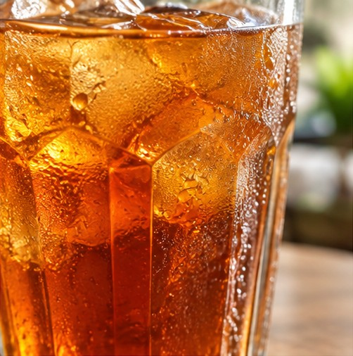
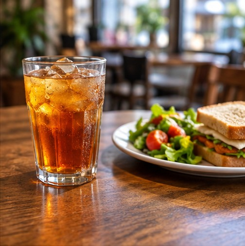
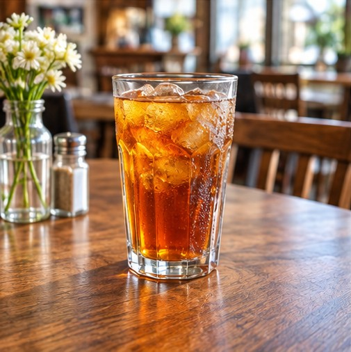
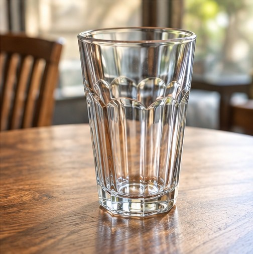
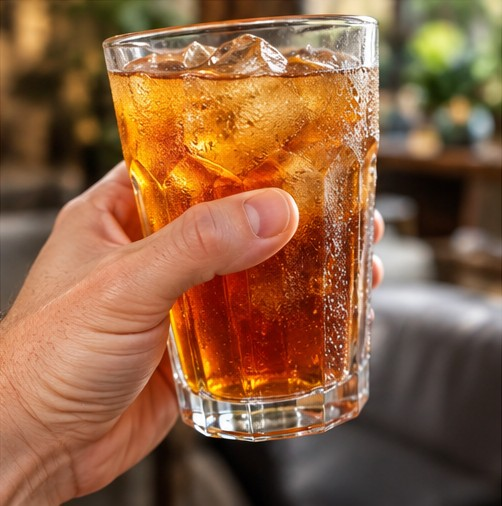

# Урок 1: Опиши стакан

## Учимся видеть и чувствовать мир по-американски

**American English Method**

**Тема:** Describing Objects  
**Уровень:** Beginner–Intermediate  
**Языковой фокус:** Nationwide American English + Southern English  
**Основной принцип:** See → Understand → Describe → Speak

---

## 1. Ситуация — The Situation

Представь, что ты сидишь в небольшом кафе на юге США.

Перед тобой на деревянном столе стоит стакан холодного чая со льдом. В южном кафе это вполне может быть **sweet tea** — сладкий холодный чай, который подслащивают ещё во время приготовления. Но не стоит считать, что каждый стакан iced tea на Юге обязательно сладкий: можно встретить и unsweetened tea.

Стакан холодный, снаружи на нём появились капельки воды. Через окно падает солнечный свет, отражается от стекла и создаёт маленькие световые блики на столе.

Ты рассматриваешь стакан и рассказываешь собеседнику, что видишь.

В этом уроке мы научимся описывать предмет не только по его названию и внешнему виду, но и через ощущения, детали, положение в пространстве и личное впечатление.

## 2. Два способа описать один предмет

В американском английском одна и та же мысль может звучать по-разному в зависимости от региона и манеры общения.

Поэтому мы рассмотрим два варианта:

- **Nationwide American English** — естественный разговорный английский, широко понятный в разных регионах США.
- **Southern English** — разговорный вариант с характерными южными особенностями.

Это не противопоставление правильного и неправильного английского. Это два варианта живой речи.

### Version A — Nationwide American English

**Natural Everyday American English**

> I've got a glass of iced tea here. It's ice-cold, and there's condensation on the outside. The glass has little facets that catch the sunlight and create tiny flashes of light on the table. Pretty nice, if you ask me.

**Перевод:**

У меня здесь стакан холодного чая со льдом. Он ледяной, а снаружи на нём образовался конденсат. У стакана есть небольшие грани, которые ловят солнечный свет и создают крошечные световые блики на столе. Очень даже неплохо, если хотите знать моё мнение.

### Version B — A Southern-Tinged Description

**A conversational description with a regional Southern touch**

> Well, that's a mighty pretty glass of sweet tea. It's ice-cold, and the glass is sweating. Those little facets catch the sunlight and throw tiny flashes of light across the table. I sure do like that.

**Перевод:**

Ну и красивый же стакан сладкого чая. Он ледяной, а сам стакан словно «потеет» от холода. Маленькие грани ловят солнечный свет и отбрасывают крошечные блики на стол. Мне это очень нравится.

**Что здесь действительно южное:** `sweet tea` — напиток, тесно связанный с культурой американского Юга, а `mighty pretty` придаёт описанию традиционную региональную окраску. `The glass is sweating` — образное разговорное выражение, понятное по всей стране, а не исключительно южная фраза. `I sure do like that` добавляет разговорную выразительность, но само по себе не является надёжным маркером южного происхождения.

Это учебный пример с лёгкой южной окраской, а не попытка изобразить единый «южный акцент». В реальной речи жители Юга говорят по-разному.

---

## 3. Listening Practice — Describing Appearance

### VOA Learning English: “Describing Pets” (6:00)

Послушай оригинальную запись VOA Learning English. Она посвящена описанию внешности животных, а не стакана. Мы используем её как дополнительную тренировку навыка: в записи хорошо слышно, как американский английский описывает размер, цвет, форму, возраст, фактуру и личное впечатление. Эти же приёмы пригодятся, когда ты описываешь стакан или любой другой предмет.

<audio controls preload="none">
  <source src="https://voa-audio.voanews.eu/vle/2023/11/21/01000000-c0a8-0242-d51e-08dbeacdc735_hq.mp3" type="audio/mpeg">
  Your browser does not support the audio element. <a href="https://voa-audio.voanews.eu/vle/2023/11/21/01000000-c0a8-0242-d51e-08dbeacdc735_hq.mp3">Open the MP3 audio</a>.
</audio>

**Источник:** VOA Learning English, “Describing Pets,” November 23, 2023.  
[Открыть оригинальную страницу и текст VOA](https://learningenglish.voanews.com/a/describing-pets/7364518.html)

**Как работать с записью:**

1. **First listen — общий смысл.** Не останавливай запись. Попробуй понять, какие особенности внешности описывает диктор.
2. **Second listen — детали.** Отметь слова, связанные с размером, цветом, возрастом, формой и впечатлением.
3. **Listen and notice — порядок прилагательных.** Обрати внимание на примеры вроде `a large, four-year-old Siamese cat` и `big, blue eyes`.
4. **Transfer — перенеси навык на стакан.** После прослушивания опиши наш стакан, используя 2–3 точных прилагательных и одну деталь поверхности.

**Важно:** это чёткая учебная запись VOA, а не спонтанная беседа и не специальная запись с южным акцентом. Она дополняет наши примеры, но не заменяет два авторских варианта описания стакана.

**Audio credit:** VOA Learning English, “Describing Pets” (November 23, 2023). Used under VOA Learning English's public-domain content policy with attribution.

---

## 4. Сравниваем два варианта

| Nationwide American English | Southern-tinged wording | Что меняется |
|---|---|---|
| `a glass of iced tea` | `a glass of sweet tea` | `Sweet tea` — сладкий холодный чай, особенно характерный для южной пищевой культуры; само выражение теперь известно и за пределами Юга |
| `Pretty nice` | `Mighty pretty` | `Mighty` придаёт фразе традиционную южную окраску; звучит более выразительно и несколько маркированно |
| `The glass is cold` | `The glass is sweating` | Второй вариант более образный и разговорный, но встречается по всей стране — это не особенность только Юга |
| `It's ice-cold` | `It's ice-cold` | Выражение естественно в обоих вариантах |
| `if you ask me` | `if you ask me` | Обычная общенациональная разговорная фраза, не региональный маркер |

Не нужно пытаться запоминать каждую разницу как строгое правило. Наша задача — научиться распознавать естественную речь и понимать её контекст.

## 5. Разбираем полезные слова и выражения

### The glass and its details

| English | Значение |
|---|---|
| a glass | стакан |
| iced tea | холодный чай со льдом; может быть сладким или несладким |
| sweet tea | сладкий холодный чай; особенно ассоциируется с американским Югом | 
| unsweetened tea / unsweet tea | несладкий холодный чай (`unsweet` — разговорное сокращение, часто встречающееся на Юге) |
| ice-cold | очень холодный, ледяной |
| condensation | конденсат, капельки влаги |
| facets | плоские грани стеклянного предмета |
| the outside | внешняя поверхность |
| sunlight | солнечный свет |
| to catch the sunlight | ловить солнечный свет |
| a flash of light | вспышка или блик света |
| tiny | крошечный |
| all over the place | повсюду, во все стороны |

### Обрати внимание на слово facets

**Facets** — это плоские грани на поверхности предмета, например огранённого стеклянного стакана.

Произношение: /ˈfæsɪts/

Не путай:

- **smooth** — гладкий;
- **rough** — шероховатый;
- **faceted** — имеющий плоские грани;
- **ridged** — имеющий выступающие рёбра или бороздки.

Если на стакане нет геометрических граней, слово facets использовать не нужно.

### Describing position

| English | Значение |
|---|---|
| next to | рядом с |
| beside | рядом, возле |
| to the left of | слева от |
| to the right of | справа от |
| in front of | перед |
| behind | позади |
| on the table | на столе |
| near the edge | возле края |

**Example:**

> The glass is next to the plate.

Стакан стоит рядом с тарелкой.

> It's to the left of the plate.

Он находится слева от тарелки.

## 6. Полезные разговорные конструкции

### 1. I've got...

В американском разговорном английском часто используется конструкция:

> I've got a glass of iced tea.

У меня есть стакан холодного чая.

Она естественна в повседневной речи.

### 2. It's got...

> It's got little facets on it.

На нём есть маленькие грани.

Разговорный способ описать особенности предмета.

### 3. When the sunlight hits it...

> When the sunlight hits the glass, it creates little flashes of light.

Когда солнечный свет падает на стакан, он создаёт маленькие блики.

Полезная конструкция для описания предметов и окружающей обстановки.

### 4. Cold enough to...

> It's cold enough to freeze my fingers.

Он настолько холодный, что пальцы могут замёрзнуть.

Это выразительное, немного преувеличенное описание ощущения.

### 5. If you ask me...

> Pretty nice, if you ask me.

По-моему, очень даже неплохо.

Распространённая разговорная фраза, с помощью которой человек выражает личное мнение.

---

## 7. Southern English Layer — Южный языковой слой

Теперь посмотрим на выражения и культурные детали, которые действительно помогают понять разговор в южном кафе. Важно отличать региональную лексику от обычных разговорных фраз, которые употребляют по всей стране.

### Sweet tea — не просто iced tea

В южном контексте `sweet tea` обычно означает холодный чай, подслащённый во время приготовления, пока чай ещё горячий. В кафе можно услышать:

> Y'all want sweet tea or unsweet?

Вам сладкий чай или несладкий?

**Nationwide equivalent:** `Would you like sweetened or unsweetened iced tea?`

`Y'all` — обращение к нескольким людям; `unsweet` — разговорная сокращённая форма от `unsweetened`. Sweet tea тесно ассоциируется с Югом, хотя сегодня его продают и общенациональные сети. Не каждый южанин пьёт только сладкий чай, и региональные привычки различаются.

### Fixin' to

Значение: собираться что-либо сделать, намереваться.

> I'm fixin' to get another glass of sweet tea.

Я собираюсь взять ещё один стакан холодного чая.

**Статус:** характерное южное разговорное выражение. В других регионах США его тоже могут понимать и употреблять, но оно не является универсальной нейтральной формой.

### Mighty

Значение: очень, весьма.

> That's mighty pretty.

Это очень красиво.

**Статус:** имеет традиционную региональную окраску, особенно в южной речи. Не следует считать его обязательной повседневной заменой слова very.

### Y'all

Значение: you all — вы, вы все.

> How are y'all doing?

Как у вас дела?

**Статус:** широко ассоциируется с американским Югом, но встречается и за его пределами. Это естественное разговорное обращение к нескольким людям.

### Ma'am and sir

Вежливые обращения к женщине и мужчине соответственно.

> Yes, ma'am.  
> Thank you, sir.

Да, мэм.  
Спасибо, сэр.

Оба обращения употребляются по всей стране. В некоторых южных коммуникативных ситуациях они особенно заметны, но это не исключительно южные выражения. Учитывай обстановку, возраст, личные предпочтения собеседника и тон общения.

**Не нужно искусственно вставлять эти обращения в каждое предложение.** `Ma'am` и `sir` — общенациональные формы вежливого обращения, а не маркеры исключительно южной речи. Естественность важнее количества региональных выражений.

---

## 8. Connected Speech — Как американцы соединяют слова

В повседневной речи американцы часто произносят соседние слова связно, с редукциями и изменениями звуков. Такие особенности встречаются по всей стране; они не являются исключительно южными. Это особенно заметно в быстрой непринуждённой беседе.

| Полная форма | Разговорное произношение | Значение |
|---|---|---|
| `Could you...?` | `Couldja...?` | Не мог бы ты...? |
| `What are you...?` | `Whatcha...?` | Что ты...? |
| `Did you...?` | `Didja...?` | Ты...? / Ты сделал...? |

Примеры:

> Couldja pass me that glass?

Не мог бы ты передать мне тот стакан?

> Whatcha drinking?

Что ты пьёшь?

> Didja try the iced tea?

Ты пробовал холодный чай?

**Важное правило:** `couldja`, `whatcha` и `didja` — не стандартное написание слов для обычного письма. Это условная передача разговорного произношения. В нормальном тексте мы пишем `could you`, `what are you` и `did you`.

---

## 9. Practice — Учимся описывать самостоятельно

Теперь попробуй описать стакан своими словами.

### Step 1 — Look

Внимательно посмотри на предмет.

- What is it?
- What color is it?
- What shape is it?
- Is it smooth or faceted?
- Is it full or empty?

### Step 2 — Notice the details

Обрати внимание на мелочи.

- Is there condensation on it?
- Does it reflect the sunlight?
- Is it next to a plate?
- Is it close to the edge of the table?

### Step 3 — Describe the feeling

Попробуй передать ощущения.

- Is it cold?
- Does it feel heavy?
- Does it look comfortable to hold?
- Does it remind you of something?

### Step 4 — Give your opinion

Добавь личное впечатление.

- It looks pretty nice.
- I really like this glass.
- It's a beautiful design.
- Pretty cool, if you ask me.

### Step 5 — Try both styles

Сначала опиши стакан на общенациональном разговорном американском английском.

Затем, если это звучит естественно, добавь один регионально окрашенный элемент. Не нужно специально вставлять несколько южных выражений в короткое описание.

---

## 10. Your Speaking Challenge

Представь, что твой американский знакомый сидит напротив тебя в кафе и спрашивает:

> What's that glass like?

Твоя задача — ответить ему, не переводя каждое русское слово буквально.

### Example A — Nationwide American English

> It's a nice glass. It's got a simple shape, but the little facets make it look interesting. It's cold to the touch, and the sunlight makes it sparkle.

### Example B — A Southern-Tinged Conversational Version

> Well, that's a mighty pretty glass of sweet tea. It's ice-cold, and the glass is sweating. Those little facets make it sparkle in the sunlight.

**Что сравнить:** `sweet tea` и `mighty pretty` дают южный культурный и языковой оттенок. `The glass is sweating` — разговорная метафора, которую поймут и в других регионах.

Это учебные примеры, а не единственно возможные способы говорить.

### Your turn

Составь собственное описание из пяти предложений:

1. Назови предмет.
2. Опиши его внешний вид.
3. Укажи одну интересную деталь.
4. Передай ощущение или личное впечатление.
5. Используй одну естественную разговорную конструкцию; южное выражение добавляй только если оно подходит ситуации.

Постарайся сначала говорить самостоятельно, не заглядывая в образцы.

---

## 11. Active and Recognition Vocabulary

Мы разделяем выражения не только по значению, но и по тому, как ученик должен ими пользоваться.

### 🟢 USE IT! — Активное употребление

Эти выражения полезно применять самостоятельно:

| Expression | Meaning |
|---|---|
| `ice-cold` | очень холодный |
| `sweet tea` | сладкий холодный чай; полезно знать и уметь заказать |
| `it's got...` | у него есть... |
| `I've got...` | у меня есть... |
| `next to` | рядом с |
| `to the left of` | слева от |
| `when the sunlight hits it...` | когда солнечный свет падает на него... |
| `pretty nice` | довольно неплохо |
| `if you ask me` | по-моему |
### 🟡 KNOW IT! — Узнавай и понимай

Эти выражения важно узнавать в разговоре. Некоторые можно использовать самостоятельно, если подходит контекст:

| Expression | Meaning |
|---|---|
| `mighty pretty` | очень красивый, с традиционной южной окраской; узнавать и использовать по ситуации |
| `unsweet` | разговорная форма «несладкий» при заказе iced tea; особенно характерна для южного ресторанного контекста |
| `fixin' to` | собираться что-либо сделать |
| `y'all` | вы, вы все |
| `ma'am` | вежливое обращение к женщине |
| `sir` | вежливое обращение к мужчине |
| `couldja` | разговорное произношение could you |
| `whatcha` | разговорное произношение what are you |
| `didja` | разговорное произношение did you |

---

## 12. What We Learned

В этом уроке мы научились:

- описывать предмет и его особенности;
- говорить о форме, поверхности и положении предметов;
- передавать ощущения и личное впечатление;
- использовать естественные разговорные американские конструкции;
- распознавать характерные выражения Southern English;
- замечать особенности Connected Speech;
- описывать один предмет в общенациональном варианте и в варианте с естественной южной окраской;
- понимать культурную разницу между iced tea и sweet tea.

### The Main Idea

**Don't just name the object. Describe the experience.**

Не просто называй предмет. Описывай свои впечатления от него.

### American English Method

**See → Understand → Describe → Speak**

Сначала научись видеть детали. Затем понимать, как их выразить. После этого описывай и говори самостоятельно.

**Learn the language. Understand the context. Express yourself naturally.**

### Regional note and further reading

- [Levine Museum of the New South — Sweet Tea](https://www.museumofthenewsouth.org/southern-tables/sweet-tea/)
- [Georgia Public Broadcasting — Sweet Tea: A History of the “Nectar of the South”](https://www.gpb.org/news/2017/05/23/sweet-tea-history-of-the-nectar-of-the-south)

These sources support the cultural association of sweet tea with the American South. They do not mean that every Southern community or household follows the same preference.
