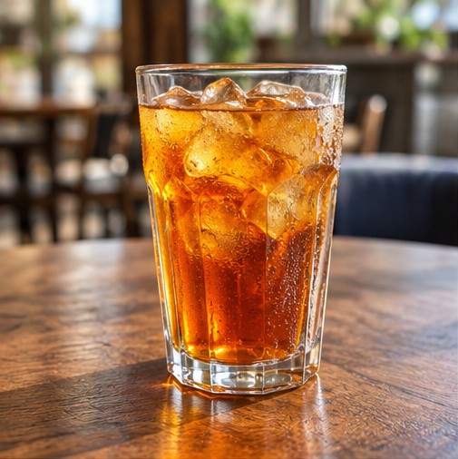

# Урок 1: Опиши стакан

## Учимся видеть и чувствовать мир по-американски

### 1. Ситуация

Ты сидишь в маленьком кафе на Юге США.

Перед тобой большой стакан чая со льдом. Он холодный, покрыт мелкими каплями конденсата и ловит солнечный свет.

Ты хочешь описать то, что видишь и чувствуешь, — **не перевести русские предложения слово в слово**, а выразить свои впечатления естественно на американском английском.

### 2. Живое описание с южным колоритом

> "I got me a glass of iced tea here. It's ice cold — cold enough to freeze my fingers. It's got these little facets on it, and when the sunlight hits the glass, it throws little flashes of light all over the place. Mighty pretty, if you ask me."

### 3. Разбор

| Выражение | Значение | Как работает |
|---|---|---|
| `I got me a glass` | Я себе взял стакан | Региональная, разговорная конструкция. `Me` добавляет неформальный, личный оттенок. |
| `Iced tea` | Холодный чай со льдом | Очень привычный напиток на Юге США. |
| `Ice cold` | Ледяной, очень холодный | Естественное усиление. |
| `Cold enough to freeze my fingers` | Такой холодный, что пальцы замерзают | Выразительный способ описать ощущение. |
| `It's got these little facets on it` | На нём есть маленькие грани | `Facets` описывает плоские поверхности гранёного стекла. |
| `When the sunlight hits it` | Когда солнечный свет падает на него | `Hits` — естественный разговорный глагол. |
| `Throws little flashes of light` | Отбрасывает маленькие вспышки света | Живой способ описать отражённый свет. |
| `All over the place` | Повсюду, во все стороны | Неформальное повседневное выражение. |
| `Mighty pretty` | Очень красиво | `Mighty` — традиционное разговорное усиление, встречается в южной речи. |
| `If you ask me` | Если меня спросить | Естественный способ выразить личное мнение. |

### 4. Южные выражения, которые стоит выучить

**`Fixin' to`**

Значит, что ты **вот-вот** что-то сделаешь или собираешься.

- `I'm fixin' to leave.` — Я собираюсь уходить.
- `It's fixin' to rain.` — Вот-вот пойдёт дождь.
- `We're fixin' to eat.` — Мы собираемся поесть.

Сильно связано с южноамериканским английским. **Не нужно** использовать в каждом предложении.

**`Y'all`**

Знакомый южный способ сказать `you all`, когда обращаешься к **нескольким людям**.

- `Y'all ready?` — Вы все готовы?
- `How are y'all doing?` — Как у вас дела?

**`Mighty`**

Неформальное усиление, означающее `very` или `extremely`.

- `That's mighty nice.` — Это очень мило.
- `It's mighty hot today.` — Сегодня очень жарко.

**`Ma'am` и `Sir`**

Вежливые формы обращения.

- `Yes, ma'am.`
- `Thank you, sir.`

Они распространены во многих южных ситуациях, но **употребление варьируется**. Не нужно добавлять их в каждый разговор.

### 5. Поток речи: слова сливаются

Американцы часто **соединяют слова** в повседневной речи. Некоторые сочетания звучат совсем не так, как пишутся.

| Звучит | Полная форма | Значение |
|---|---|---|
| `Couldja...?` | `Could you...?` | Не могли бы вы...? |
| `Whatcha doing?` | `What are you doing?` | Что ты делаешь? |
| `Didja see that?` | `Did you see that?` | Ты это видел? |

Это **неформальная запись произношения**. В обычном письме используй полные формы.

Попробуй сказать их естественно:

- `Couldja pass me that glass?`
- `Whatcha looking at?`
- `Didja notice the sunlight?`

**Не форсируй произношение.** Цель — понимать связную речь и постепенно воспроизводить её естественно.

---

# Часть 2. Практическое упражнение — опиши предмет

### Твоя задача

Выбери любой предмет перед собой:

- Телефон
- Кофейная чашка
- Стакан воды
- Книга
- Часы
- Очки

Опиши его в **пяти предложениях**.

Постарайся включить:

1. Что это за предмет.
2. Как он выглядит или ощущается.
3. Одну деталь о его форме, цвете, текстуре или поверхности.
4. Одно личное впечатление или сравнение.
5. Одно выражение с южным колоритом.

Также постарайся включить **один пример связной речи** — `couldja`, `whatcha` или `didja`.

### Пример: кофейная чашка

> "I got me a cup of coffee here. It's nice and hot, and I can feel the warmth coming through the cup. It's got a smooth surface and a little crack near the handle. The coffee smells mighty good. Whatcha think — pretty nice-looking cup, huh?"

### Как тренироваться

- Сначала **напиши** пять предложений.
- Потом прочитай их **вслух медленно**.
- Повтори в **естественном разговорном темпе**.
- Обрати внимание на **ритм, слитные слова и ударные слоги**.
- **Не преувеличивай** южный акцент.

---

# Твой активный словарь

**🟢 Активно — используй эти выражения**

- `Ice cold`
- `Fixin' to`
- `Mighty`
- `Ma'am`
- `Sir`
- `Y'all`
- `It's got...`
- `When the sunlight hits it...`

**🟡 Понимать — узнавай эти выражения**

- `Them` вместо `those` в некоторых региональных вариантах.
- `Couldja`
- `Whatcha`
- `Didja`
- `All over the place`
- `If you ask me`

**Главный принцип:**

Не просто описывай, **что это за предмет**.

Описывай, **как он выглядит**, **как ощущается**, **что ты в нём замечаешь** и **какое впечатление он производит**.

**Не переводи предмет. Описывай опыт.**

## Статус лексики

- 🟢 **Активно:** `ice cold`, `fixin' to`, `mighty`, `ma'am`, `sir`, `y'all`, `it's got...`, `when the sunlight hits it...`
- 🟡 **Понимать:** `them` вместо `those` (региональный вариант), `couldja`, `whatcha`, `didja`, `all over the place`, `if you ask me`
- 🔴 **Пассивно:** —
